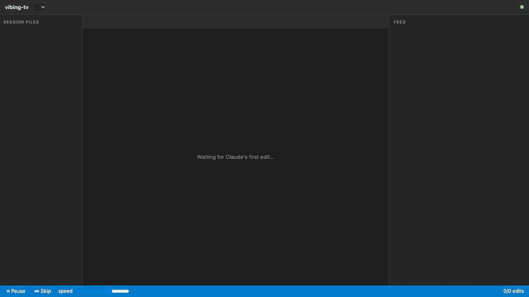

# vibing-tv

[](https://github.com/CharlesRA/vibing-tv/actions/workflows/ci.yml)
[](LICENSE)
[](https://github.com/CharlesRA/vibing-tv/releases)

**A Claude Code plugin to watch Claude write code, live, with its reasoning alongside.**



vibing-tv is a live viewer for [Claude Code](https://docs.claude.com/en/docs/claude-code/overview). Every file Claude
creates or edits is typed into a VS Code–style editor in your browser, character by character. Next to it, a feed shows
what Claude said it was doing, and its checklist stays pinned at the top.

Follow Claude the way you would watch a teammate code, and spend less time reading diffs afterwards.

## Why

When an AI coding agent works on its own, you usually see a scrolling terminal and, at the end, a large diff. vibing-tv
shows you what Claude Code is doing while it does it:

- **See each change as it happens**, in context, instead of reviewing everything at the end.
- **Know why a file changed**: each edit sits under the explanation Claude gave for it.
- **Catch a wrong turn early**, and interrupt Claude before it builds on it.
- **Show it to others**: pair programming with an agent, demos, teaching, or streaming a vibe coding session.

## Install

One command, in your terminal:

```bash
claude plugin install vibing-tv --marketplace CharlesRA/vibing-tv
```

Or from inside a Claude Code session:

```
/plugin install vibing-tv --marketplace CharlesRA/vibing-tv
```

Then start a new Claude Code session. **Claude's first reply gives you the link** to the viewer
(http://127.0.0.1:4317 by default). Open it and ask Claude to build something.

<details>
<summary>Claude Code older than 2.1.292</summary>

```bash
claude plugin marketplace add CharlesRA/vibing-tv
claude plugin install vibing-tv@vibing-tv
```

</details>

**Requirements:** Claude Code 2.1.292 or later (tested with 2.1.327), and Node.js 22.18 or later on your `PATH`. The
hooks are run with `node`; without it, the plugin does nothing.

## Features

- **Live typing.** New files are typed from the top; edits highlight the text that goes away, then type what replaces
  it. Only the part that really changes is animated.
- **Claude's reasoning next to the code.** The feed groups edits under the sentence Claude wrote before them.
- **Pinned steps.** Claude's markdown checklist (`- [ ]` / `- [x]`) shows as a progress list above the feed.
- **Replay.** Click a file in the feed to replay that edit. Pause, skip, and change the typing speed from the controls
  above the editor, or from the keyboard: <kbd>Space</kbd> pauses, <kbd>→</kbd> skips, <kbd>S</kbd> picks a session.
- **Every session.** One viewer for all your Claude Code sessions; it follows the latest one until you pick one yourself.
- **Local and offline.** Everything stays on your machine. The viewer is bundled with the plugin and makes no request to
  any other site.

## How it works

```
Claude Code ── hooks ──▶ capture ── append ──▶ ~/.vibing-tv/sessions/<session>.jsonl
                                                        │
                       local server (127.0.0.1:4317) ◀──┘ ── live stream ──▶ viewer in your browser
```

- A `PostToolUse` hook records each `Write` and `Edit`: the file before and after, and the text Claude wrote before it.
  It runs in about a millisecond and never slows Claude down.
- A `SessionStart` hook starts a small local server if none is running, and adds a short instruction to Claude's
  context: explain each group of edits in a sentence or two, keep a checklist for multi-step tasks, and give you the
  viewer's link in the first reply.
- The server streams new edits to the viewer, which types them into [Monaco](https://microsoft.github.io/monaco-editor/).

Details: [docs/ARCHITECTURE.md](docs/ARCHITECTURE.md).

## Token usage

The hooks, the server and the viewer never call the model. What does cost tokens:

- **The injected instructions** (about 150 tokens). They stay in context and are normally served from the prompt cache.
- **The explanations and checklists Claude writes** for the feed, as output tokens.

On a small "build a todo app" task, this added about 500 to 650 output tokens and 2 to 6 % to the total cost. See
[docs/token-usage.md](docs/token-usage.md) for the method and the numbers. To turn the extra text off, set
`VIBING_TV_NO_COACH=1`: the code is still typed live, but the feed and the steps stay empty.

## Privacy

- vibing-tv stores, on your machine only, the full content of each file Claude edits (before and after), in
  `~/.vibing-tv`. Logs are deleted after 7 days.
- It never records `.env*`, `*.pem`, `*.key`, `*.p12` or `id_rsa*` files. Files over 1 MB are recorded without their
  content.
- The server listens on `127.0.0.1` only. No telemetry.
- **Uninstalling does not delete `~/.vibing-tv`.** Remove it with `rm -rf ~/.vibing-tv`.

More in [SECURITY.md](SECURITY.md).

## Configuration

Set these environment variables before starting Claude Code:

| Variable             | Default        | Effect                                                     |
| -------------------- | -------------- | ---------------------------------------------------------- |
| `VIBING_TV_PORT`     | `4317`         | Port of the local server and viewer                        |
| `VIBING_TV_DATA_DIR` | `~/.vibing-tv` | Where session logs are stored                              |
| `VIBING_TV_IDLE_MS`  | `1800000`      | The server stops after this long without activity (30 min) |
| `VIBING_TV_NO_COACH` | unset          | `1`: don't ask Claude to explain its edits                 |
| `VIBING_TV_NO_LINK`  | unset          | `1`: don't ask Claude to give the viewer's link            |

## Troubleshooting

- **Claude gave no link.** The link is only given at the start of a new conversation (not after `--resume`). Check that
  the server answers: `curl http://127.0.0.1:4317/health` should return `{"app":"vibing-tv",…}`.
- **Another app uses port 4317.** vibing-tv leaves it alone, writes `port 4317 busy with another app` to
  `~/.vibing-tv/server.log`, and gives no link. Set `VIBING_TV_PORT` to a free port.
- **Edits show up but the feed says "(explanation pending…)".** Claude Code writes its transcript in batches; the
  explanation usually appears within a few seconds.
- **Nothing shows up at all.** Check that `node --version` works in the shell Claude Code starts from, then look at
  `~/.vibing-tv/server.log`. `claude --debug` shows how the hooks load and run.
- **Two sessions use different `VIBING_TV_DATA_DIR`.** One server runs per machine; the second session keeps the
  running server and logs the mismatch. Use the same folder everywhere.

## Development

```bash
npm ci
npm run dev                  # builds dist/ and rebuilds on change
claude --plugin-dir ./dist   # in another terminal
```

See [CONTRIBUTING.md](CONTRIBUTING.md).

## License

[MIT](LICENSE)
